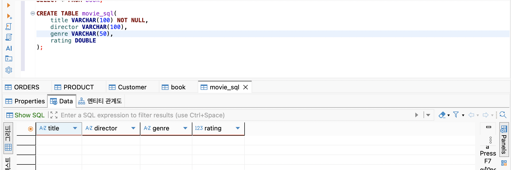
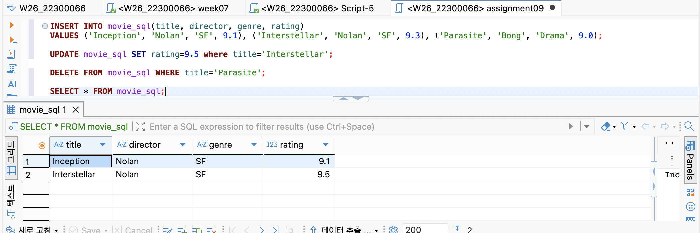
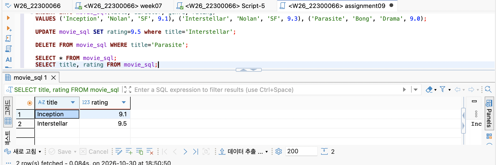
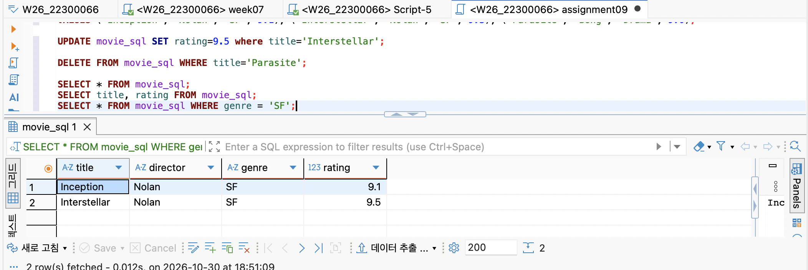

## ① 프로젝트 소개
### 주제 및 주요 기능
영화의 데이터를 CRUD할 수 있는 프로젝트

### Entity 필드 구조
id(PK), title, author, price, releaseYear, genre

### 프로젝트 구조 및 개발환경
Spring JPA, Spring Web, MariaDB 사용  
기존의 프로젝트와 파일 구조는 동일  
github으로 push-> dockerfile을 인식한 render에서 배포-> postman으로 요청 가능 -> DBeaver에서 데이터 확인

### GitHub Repository URL
https://github.com/2026-2-WebService/assign06-c01-22300066.git
### Render Deployment URL
https://wsd-assign09.onrender.com/
(RequestMapping은 /api/movies)

## ② Database SQL Practice
### 기존 Table 조회 및 데이터 추가 결과

### 새 Table 생성 SQL!

### INSERT / UPDATE / DELETE / SELECT SQL과 실행 결과

### DBeaver 실행 화면 또는 결과

## ③ Spring Data JPA 구현
### Entity 및 JpaRepository 설명
Entity는 실제 데이터베이스의 테이블에 연결되는 객체  
JpaRepository는 데이터베이스에 쉽게 CRUD를 할 수 있게 도와주는 인터페이스

### 사용한 Annotation의 역할
@Entity: JPA가 관리하는 클래스임을 표시     
@Table: 데이터베이스의 어떤 테이블과 연결할 것인지 표시  
@Id: Primary Key로 지정    
@GeneratedValue: Primary Key를 자동 생성, AUTO INCREMENT  
@Column: 필드와 DB 테이블의 컬럼을 연결 해주고 특정 속성도 설정 가능

### REST API Endpoint 목록 및 요청·응답 JSON
GET(id)/POST/UPDATE id/ DELETE id   
요청 JSON에는 id를 제외한 필드들이 있고 응답 JSON에는 id까지 포함되어 있음

### JPA Entity와 MariaDB Table 비교
JPA Entity에 정의한 데이터와 MariaDB에 정의한 데이터와 동일함

## ④ JPA와 SQL 비교
### save(), findAll(), findById(), deleteById() 사용 결과
실제 데이터베이스에 있는 데이터도 같이 바뀌며 DBeaver를 통해서 확인할 수 있다.

### 실제 Hibernate SQL 확인
예) Hibernate: select m1_0.id,m1_0.author,m1_0.genre,m1_0.price,m1_0.release_year,m1_0.title from movie_sql2 m1_0

### SQL을 직접 작성하는 방식과 JPA 방식의 차이
SQL문을 직접 코드에 작성하지 않아도 되어서 코드가 간결해진다.

## ⑤ 배포 및 환경 설정
### IntelliJ 및 Render 환경변수 설정 방법(변수명만 기록)
DB_URL, DB_USERNAME, DB_PASSWORD

### Render 배포 과정
github에 푸쉬 -> Render에서 환경변수 설정하고 배포

### 배포 URL의 CRUD 테스트 결과
정상적으로 URL을 입력하여 MariaDB에 데이터가 저장됨을 확인할 수 있음

### MariaDB 데이터 저장 확인
DBeaver로 확인할 수 있음

### 발생한 문제와 해결 방법
이미 movie_sql이라는 이름의 테이블이 존재하는데 그 테이블에는 필드가 작성한 코드의 필드와 달라서 인식을 하지 못하는 오류가 있었음 -> movie_sql2라는 새로운 테이블을 만들어서 사용

## ⑥ Weekly Report
### Key Learning: 새롭게 이해한 내용 3가지
1. JpaRepository를 사용할 때는 implements가 아닌 extends를 사용함
2. JpaRepository를 사용하면 save, findAll, findById, deleteById을 따로 구현할 필요 없이 사용할 수 있음
3. 알려지면 안되는 정보들은 환경변수에 저장할 수 있음

### Problem & Solution: 문제 1개 이상과 해결 과정
이미 movie_sql이라는 이름의 테이블이 존재하는데 그 테이블에는 필드가 작성한 코드의 필드와 달라서 인식을 하지 못하는 오류가 있었음 -> movie_sql2라는 새로운 테이블을 만들어서 사용

### Code Review: 중요한 코드 1개와 동작 설명
public interface MovieRepository extends JpaRepository<Movie, Long> { }
JpaRepository가 제공하는 기능들을 상속 받아서 사용할 수 있도록 해줌

### AI Usage: AI 활용 내용 및 직접 수정·검증한 부분, 자신이 생각하는 AI사용률(%)
이미 movie_sql이라는 이름의 테이블이 존재하는데 그 테이블에는 필드가 작성한 코드의 필드와 달라서 인식을 하지 못하는 오류가 있었음 -> movie_sql2라는 새로운 테이블을 만들어서 사용
, 10%

### Reflection: 추가로 공부하고 싶은 내용
왜 기본 포트 번호가 8080이 되었는지